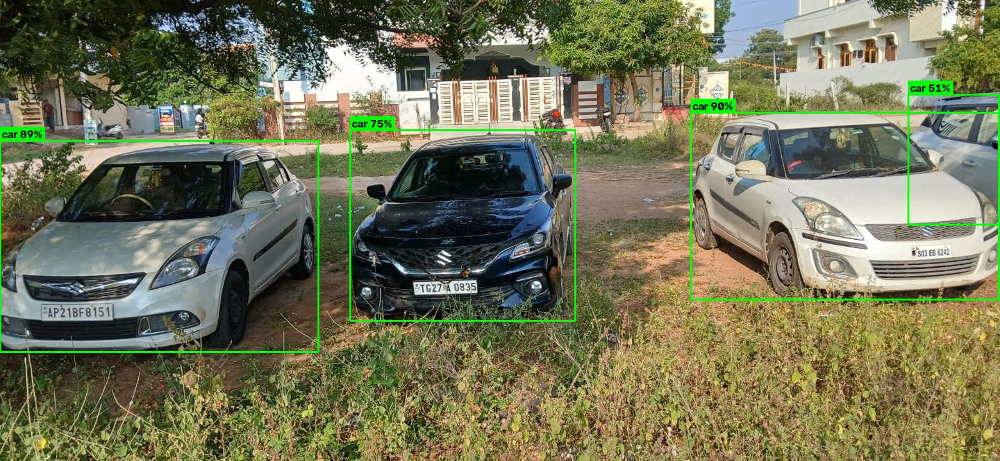

# Bay Occupancy Detector

Camera-based vehicle detection for parking and EV charging bays, written in
C++ with OpenCV. The end goal is to draw bay zones on a camera view and report
which bays are occupied, running on a Raspberry Pi or Jetson.



## Current status

Vehicle detection on still images works. It runs a YOLO11 model (ONNX) through
OpenCV's DNN module, keeps only vehicles (car, motorcycle, bus, truck), removes
duplicate boxes, then draws, prints and saves the result.

Bay zones and occupancy logic are not built yet. See the roadmap.

## How it works

1. **Letterbox** the image to 640x640 without stretching it (grey padding)
2. **Run YOLO11** and read its output of 8400 candidate boxes
3. **Keep vehicles** above the confidence threshold and map the boxes back to original pixels
4. **Non-maximum suppression** removes duplicate boxes for the same vehicle
5. **Draw, print and save** the result

## Project structure

```
bay_occupancy_detector/
├── bay_occupancy_detector.sln        Visual Studio solution
├── bay_occupancy_detector.vcxproj    Project file (OpenCV paths, build settings)
├── src/
│   ├── main.cpp                      Arguments, load image and model, report, save, show
│   ├── vehicle_detector.h/.cpp       VehicleDetector: runs the ONNX model, returns vehicles
│   ├── letterbox.h/.cpp              Resize-and-pad to model input, map boxes back
│   ├── coco_classes.h/.cpp           80 COCO class names and the vehicle filter
│   ├── drawing.h/.cpp                Labels and drawing boxes
│   └── detection.h                   Detection struct (box, score, class)
├── samples/                          Test images
├── models/                           yolo11n.onnx model is included here
└── docs/                             Screenshots
```

## Requirements

- Windows 10/11 with Visual Studio 2022 (Desktop development with C++)
- OpenCV 4.8 or newer for Windows (developed with OpenCV 5.0.0)
- `yolo11n.onnx` exported at 640x640

## Setup

1. Install OpenCV, e.g. to `C:\opencv`
2. Create a Windows environment variable `OPENCV_DIR` pointing to the folder
   that contains `bin` and `lib`, e.g. `C:\opencv\build\x64\vc16`
3. If your OpenCV version is not 5.0.0, change `<OpenCVVersion>500</OpenCVVersion>`
   in `bay_occupancy_detector.vcxproj` to match your library name
   (e.g. `opencv_world4100.lib` → `4100`)
4. Put the model in `models/` (see `models/README.md`)
5. Put a test image at `samples/Car_Image.jpg`

## Build and run

Open `bay_occupancy_detector.sln`, choose **Debug** or **Release** and **x64**,
then press **Ctrl+F5**. Visual Studio runs it from the project folder with:

```
samples\Car_Image.jpg models\yolo11n.onnx docs\result.jpg
```

## Roadmap

- Bay zones loaded from a config file
- Occupancy logic: decide whether a detected vehicle sits inside a bay (overlap threshold)
- Live webcam input with `cv::VideoCapture`
- Unit tests for the occupancy logic
- CMake build for Raspberry Pi
- Publish bay status as JSON / MQTT
